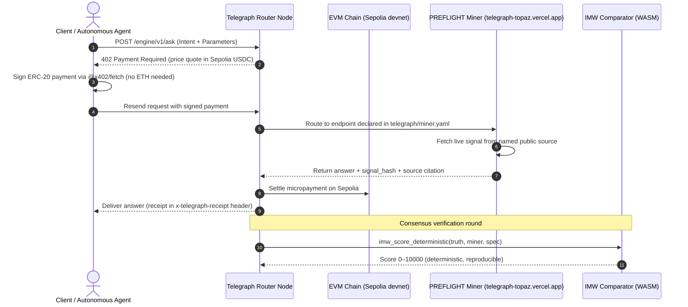

# preflight-miner-config

PREFLIGHT Infrastructure Signals is a Telegraph Protocol miner (Provider). It answers 136 Intents,
reading each answer live at question time from a named public source: TLS handshakes, DNS over two
resolvers, uptime probes, JSON-RPC on 16 chains, ECB FX, SEC filings, NVD CVEs and others.

| | |
|---|---|
| Registration | **6214** on the Telegraph devnode, slug `a1-preflight` ([status](https://devnode.telegraphprotocol.com/api/miners/6214)) |
| Service | **https://telegraph-topaz.vercel.app** ([health](https://telegraph-topaz.vercel.app/health)) |
| Manifest | [`telegraph/miner.yaml`](telegraph/miner.yaml), pinned by commit; the node fetches it from an immutable `raw.githubusercontent.com/.../<commit>/telegraph/miner.yaml` URL and checks its SHA-256 against the registered hash |
| Network | Telegraph devnode, payments in Sepolia test USDC. This is testnet, not production demand. |
| Price | $0.01 per request |

## Try it

No key is needed to call the service directly:

```sh
# TLS certificate check: real handshake, chain and expiry
curl -s "https://telegraph-topaz.vercel.app/ssl-check?domain=github.com"

# Gas price on Base, from public JSON-RPC
curl -s "https://telegraph-topaz.vercel.app/gas-price?chain=base"

# Deterministic comparator (the network's reference scoring rule)
curl -s -X POST https://telegraph-topaz.vercel.app/comparator \
  -H 'content-type: application/json' \
  -d '{"batch":[{"ground_truth_value":100,"miner_value":101,"spec":[2,200]}]}'
```

Every answer carries `found`, `confidence`, a plain-language `reason` naming its source, and the
time it was checked. When a check cannot be made (an input that does not exist, a private address,
a source that is down), the answer says so with `found: false` instead of guessing.

To buy an answer through Telegraph with ranked routing and a payment receipt, follow the tutorial
below. Every endpoint and its parameters are listed in the manifest.

## Tutorial

[Your first paid agent on Telegraph, in 90 lines](examples/first-paid-agent/README.md): pay per request,
check the answer, ask for a second opinion, or hold. It runs on Sepolia test USDC.

## Apps that consume it

These three apps are operated by the same team as this miner. Their use is labelled related party
and is not presented as outside demand.

- Listing Desk: https://telegraph-topaz.vercel.app/desk
- Allocation Agent: https://telegraph-topaz.vercel.app/allocator
- Counterparty Check: https://telegraph-topaz.vercel.app/diligence

Run records with their settlement transactions are in [`evidence/`](evidence/), one folder per date.

## History and known limits

- **Hosting moved on 2026-11-27.** The service ran on Vercel (registrations 377, 5113 and 5218) until Vercel suspended the Hobby deployment
  for usage on 2026-11-26 at 11:20 UTC. Since 2026-11-27 it has served from Netlify as registration
  6214. Older evidence names the Vercel URLs; those records are kept as they were. The miner id
  for direct requests (`/engine/v1/ask/20260828`) is unchanged and now reaches Netlify.
- **Model-answered Intents** (summaries, captions, Q&A and similar) use free LLM tiers. When the
  daily quota runs out, the answer says so with `found: false`. Repeated questions are cached for
  up to 24 hours.
- **Uptime** is measured from AWS us-east-2 (Ohio). A question that names places ("from London")
  is also probed from those places on Globalping's public network.

---

## Architecture & System Overview

PREFLIGHT is a live-data oracle miner registered on the Telegraph Protocol network. Every intent is
answered by querying a named, verifiable public source at request time — there is no caching of
answers, no model hallucination, and no guessing. The scoring of answers is performed by a
deterministic WebAssembly module so any party can reproduce the score from the raw values.

### High-Level Data & Settlement Flow



### How registration #6214 differs from earlier registrations

The service previously ran under registrations 377, 5113, and 5218 on Vercel. After Vercel
suspended the Hobby deployment on 2026-11-26, the service moved to Netlify under registration 6214.
The miner ID (`20260828`) and all intent mappings are unchanged — only the `base_url` changed.
Older evidence records in `evidence/` reference the Vercel URLs and are kept as-is.

---

## Core Components

| Component | Path | Description |
|---|---|---|
| **Miner Manifest** | [`telegraph/miner.yaml`](telegraph/miner.yaml) | 136 intents mapped to REST endpoints on `telegraph-topaz.vercel.app`. Commit-pinned and SHA-256 verified on-chain by the Telegraph node before routing. |
| **Comparator WASM** | [`comparator/`](comparator/) | Zero-import `wasm32-unknown-unknown` scoring modules. The reference module scores Exact, AbsTol, and RelTol; per-family builds add a named `preflight.family` custom section. |
| **Agent Example** | [`examples/first-paid-agent/`](examples/first-paid-agent/) | 90-line buyer agent using `@x402/fetch` on Sepolia USDC — demonstrates payment, response verification, second-opinion routing, and HOLD fallback. |
| **Evidence** | [`evidence/`](evidence/) | Timestamped JSON run records with on-chain settlement transaction hashes, one folder per date. |

---

## Supported Signal Families

| Family | Endpoints | Sources |
|---|---|---|
| **TLS / Web Safety** | `/ssl-check`, `/url-scan`, `/url-safe`, `/malware-check` | Live TLS handshake, redirect chain, security headers, threat feeds |
| **DNS** | `/dns` | Cloudflare DoH + Google DoH (dual-resolver) |
| **On-Chain / EVM** | `/gas-price`, `/wallet-balance`, `/tx-lookup`, `/token-supply`, `/onchain-metric`, `/cross-chain` | Public JSON-RPC across 16 chains (Ethereum, Base, Arbitrum, Optimism, Polygon, BNB, Avalanche, Linea, Scroll, Gnosis, zkSync, Blast, Mantle, Celo, Sonic, Unichain) |
| **DeFi / Markets** | `/crypto-price`, `/tvl`, `/liquidity`, `/yield`, `/holders`, `/market-cap` | DefiLlama, public aggregators |
| **Infrastructure** | `/uptime`, `/api-health` | Live probes with per-phase latency |
| **Finance / Macro** | `/fx-rate`, `/stock-price`, `/macro`, `/loan-rate`, `/hashprice` | Named public data sources cited in each answer |
| **Compliance / Risk** | `/sanctions`, `/threat-intel`, `/fraud-risk`, `/transaction-risk`, `/kyc` | Public threat and sanctions feeds |
| **AI / NLP** | `/summarize`, `/translate`, `/fact-check`, `/sentiment`, `/classify`, `/extract`, `/chat` | Free LLM tiers (quota-limited; `found: false` when exhausted) |
| **Deterministic Scoring** | `/comparator`, `/comparator/<FAMILY>` | WASM module — Exact (0), AbsTol (1), RelTol (2), PassFail (3) |
