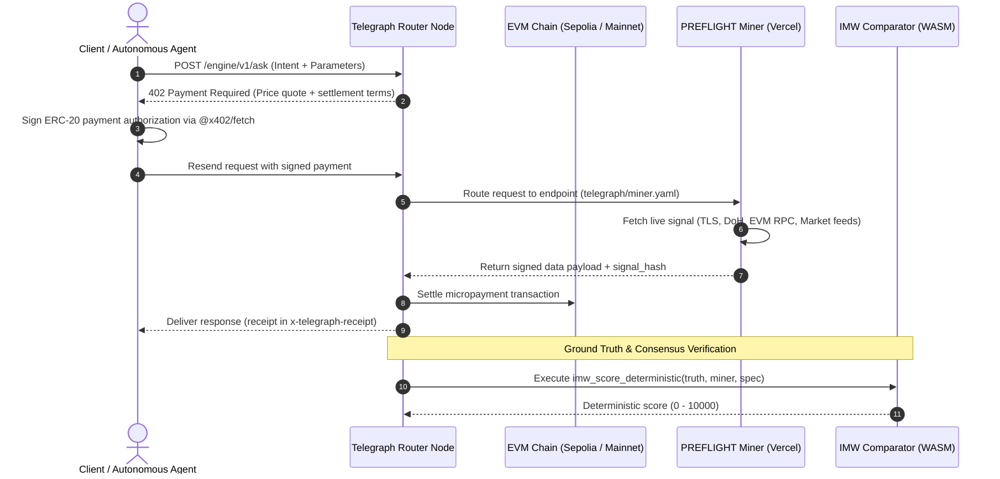

# preflight-miner-config

PREFLIGHT Infrastructure Signals is a Telegraph Protocol miner (Provider). It answers 136 Intents,
reading each answer live at question time from a named public source: TLS handshakes, DNS over two
resolvers, uptime probes, JSON-RPC on 16 chains, ECB FX, SEC filings, NVD CVEs and others.

| | |
|---|---|
| Registration | **6214** on the Telegraph devnode, slug `a1-preflight` ([status](https://devnode.telegraphprotocol.com/api/miners/6214)) |
| Service | **https://telegraph-topaz.vercel.app** ([health](https://telegraph-topaz.vercel.app/health)) |
| Manifest | [`telegraph/miner.yaml`](telegraph/miner.yaml), pinned by commit; the node fetches it from an immutable `raw.githubusercontent.com/.../<commit>/telegraph/miner.yaml` URL and checks its SHA-256 against the registered hash |
| Network | Telegraph devnode, payments in Sepolia test USDC. This is testnet, not production demand. |
| Price | $0.01 per request |

## Try it

No key is needed to call the service directly:

```sh
# TLS certificate check: real handshake, chain and expiry
curl -s "https://telegraph-topaz.vercel.app/ssl-check?domain=github.com"

# Gas price on Base, from public JSON-RPC
curl -s "https://telegraph-topaz.vercel.app/gas-price?chain=base"

# Deterministic comparator (the network's reference scoring rule)
curl -s -X POST https://telegraph-topaz.vercel.app/comparator \
  -H 'content-type: application/json' \
  -d '{"batch":[{"ground_truth_value":100,"miner_value":101,"spec":[2,200]}]}'
```

Every answer carries `found`, `confidence`, a plain-language `reason` naming its source, and the
time it was checked. When a check cannot be made (an input that does not exist, a private address,
a source that is down), the answer says so with `found: false` instead of guessing.

To buy an answer through Telegraph with ranked routing and a payment receipt, follow the tutorial
below. Every endpoint and its parameters are listed in the manifest.

## Tutorial

[Your first paid agent on Telegraph, in 90 lines](examples/first-paid-agent/README.md): pay per request,
check the answer, ask for a second opinion, or hold. It runs on Sepolia test USDC.

## Apps that consume it

These three apps are operated by the same team as this miner. Their use is labelled related party
and is not presented as outside demand.

- Listing Desk: https://telegraph-topaz.vercel.app/desk
- Allocation Agent: https://telegraph-topaz.vercel.app/allocator
- Counterparty Check: https://telegraph-topaz.vercel.app/diligence

Run records with their settlement transactions are in [`evidence/`](evidence/), one folder per date.

## History and known limits

- **Hosting moved on 2026-11-27.** The service ran on Vercel (registrations 377, 5113 and 5218) until Vercel suspended the Hobby deployment
  for usage on 2026-11-26 at 11:20 UTC. Since 2026-11-27 it has served from Netlify as registration
  6214. Older evidence names the Vercel URLs; those records are kept as they were. The miner id
  for direct requests (`/engine/v1/ask/20260828`) is unchanged and now reaches Netlify.
- **Model-answered Intents** (summaries, captions, Q&A and similar) use free LLM tiers. When the
  daily quota runs out, the answer says so with `found: false`. Repeated questions are cached for
  up to 24 hours.
- **Uptime** is measured from AWS us-east-2 (Ohio). A question that names places ("from London")
  is also probed from those places on Globalping's public network.

---

## Architecture & System Overview

PREFLIGHT serves as a high-integrity oracle and deterministic signal provider for autonomous systems across web infrastructure, decentralized finance (DeFi), and cross-chain networks.

### High-Level Data & Settlement Flow



---

## Core Components

| Component | Path | Description |
|---|---|---|
| **Miner Manifest** | [`telegraph/miner.yaml`](telegraph/miner.yaml) | Declarative mapping of ~3,300 lines defining supported intents, REST endpoints, parameter schemas, circuit breakers, and rate limits. |
| **Scoring Modules** | [`comparator/`](comparator/) | Compiled WebAssembly modules (`wasm32-unknown-unknown`) implementing zero-import deterministic scoring rules for consensus rounds. |
| **Agent Example** | [`examples/first-paid-agent/`](examples/first-paid-agent/) | Minimal 90-line autonomous buyer agent using `@x402/fetch` on Sepolia test USDC to purchase and cross-verify infrastructure signals. |

---

## Supported Signal Families

* **TLS / Infrastructure Health:** Real-time TLS certificate handshake verification (chain trust, hostname matching, expiry dates) and multi-phase latency probing.
* **DNS Verification:** Independent Dual-resolver DNS-over-HTTPS (DoH) lookups.
* **On-Chain Reads:** State reads, gas prices, token total supplies, and account balances across 16+ EVM chains (Ethereum, Base, Arbitrum, Optimism, Polygon, BNB Chain, Avalanche, Linea, Scroll, Gnosis, zkSync, Blast, Mantle, Celo, Sonic, Unichain).
* **Deterministic Scoring (IMW):** Embedded WASM evaluators supporting Exact (Code 0), Absolute Tolerance (Code 1), Relative Tolerance (Code 2), and Pass/Fail (Code 3).
